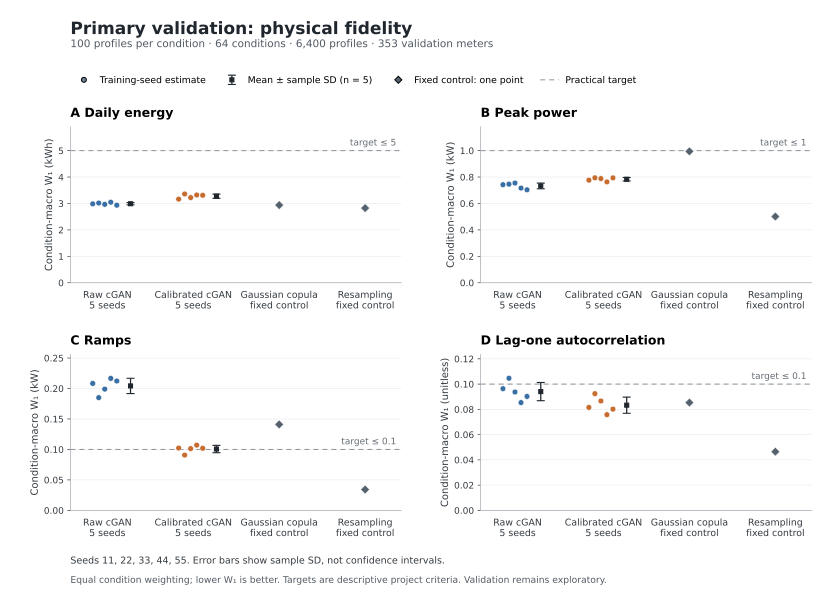

# Fluvius cGAN — V2

A reproducible adaptation of [malvin0130/cGAN_EB](https://github.com/malvin0130/cGAN_EB)
for the Fluvius residential electricity dataset in this repository's
[`data` release](https://github.com/MahmoudAsadi97/cGAN/releases/tag/data).
All development is on **V2**; `main` is unchanged. This is a research baseline;
passing tests or a short training run does not establish publication readiness.

**Current study:** the identity-curated, fixed-calibration candidate is defined in
[CALIBRATION_STUDY.md](docs/CALIBRATION_STUDY.md). All five curated SWD10 runs and
their primary/precision calibration evaluations are complete. Mean primary ramp
W1 is 0.100655 kW, 28.63% below the matched Gaussian copula, but narrowly above
the fixed 0.10 kW practical target. Daily-energy and whole-profile tradeoffs remain;
see [the robustness report](docs/CURATED_CALIBRATION_ROBUSTNESS.md). All five
observed-history utility checks meet the declared tolerance, and the
[completed validation report](docs/CURATED_COMPLETED_VALIDATION.md) retains each
seed's paired uncertainty and the stronger resampling results. This is
validation evidence, not a completed publication result. A fixed three-seed
[temporal-loss refinement](docs/TEMPORAL_REFINEMENT.md) is now being tested;
final test performance remains unseen. Earlier reference-architecture runs and
normalization screens are historical exploratory evidence, not results for this candidate.

**Data-audit update:** different meter IDs were found to share exact full-year
traces across the original train/validation split. Earlier reported scores are
exploratory and do not establish independent-trace validation. A deterministic
deduplication procedure preserves the original held-out test membership while
removing aliases; see [DUPLICATE_REMEDIATION.md](docs/DUPLICATE_REMEDIATION.md).

## What it generates

Daily **net grid import** (`import − injection`) in kWh per interval, conditioned on
reported heat pump, EV and PV indicators, weekend and season. Negative net values
mean grid export. The current study generates **96 quarter-hour energy values per
day**. Divide each value by 0.25 hours to obtain interval-average kW; summing the
96 values gives daily net energy in kWh. The general preparation code also supports
24 hourly energy sums.
Import-only and injection-only targets are also supported. This data does not reveal
gross household load, PV generation, or separate EV charging demand.

The original MLP/BCE adaptation is retained for attribution experiments; see
[UPSTREAM_ADAPTATION.md](docs/UPSTREAM_ADAPTATION.md). The current candidate uses
train-only standard normalization, a spectral-normalized hinge discriminator,
conditional sliced-Wasserstein training loss, and a saved conditional marginal
map applied after generation. The map approximately moves margins toward the
training distribution. It does not independently establish learned temporal
dependence, and its interpolation can create ties and endpoint saturation.

## Install and run

Python 3.10 or later. Install a suitable PyTorch build for your CPU/GPU first if needed.
From the repository directory:

```bash
git switch V2
python -m venv .venv
source .venv/bin/activate
python -m pip install -e '.[dev,plots]'
python -m pytest -q

# Download about 395 MB and verify the pinned SHA-256; no 6.4 GB extraction needed.
fluvius-cgan download --output data/raw.zip
fluvius-cgan audit --archive data/raw.zip --output reports/archive_audit.json

# Full dataset, all 8 equipment groups, all complete non-DST days.
fluvius-cgan prepare --archive data/raw.zip --output data/prepared96 --resolution 96

# Remove exact complete-trace aliases while preserving original held-out membership.
python scripts/curate_prepared.py --prepared data/prepared96 --output data/curated96

# Smoke-check raw training and validation before the full study.
fluvius-cgan train --prepared data/curated96 --config configs/smoke.json --output runs/smoke
fluvius-cgan evaluate --prepared data/curated96 --checkpoint runs/smoke/best.pt --output runs/smoke/validation.json
```

Use `python -m fluvius_cgan` instead of the installed command if preferred.
PowerShell activation is `.venv\Scripts\Activate.ps1`. Run directories must be new
or empty; reuse is rejected to avoid mixing experiments. Checkpoints currently start
new runs only; optimizer states are saved for inspection, but resume is not implemented.
Raw data, prepared arrays, checkpoints and generated profiles are ignored by git.

For a faster ingestion check, use `--max-meters-per-group 3 --output data/prepared_smoke`.
That selects the earliest meters and is intentionally biased; it is only a software
smoke check. The training smoke config separately samples at most 4,096 training days
and runs 3 epochs. Neither shortcut is suitable for a manuscript's main results.
The observed research environment is recorded in
[requirements-research.txt](requirements-research.txt).

## Current curated calibration study



The figure shows the original SWD10 arm's primary validation results. Dots retain
every declared neural seed; error bars are sample SD, not confidence intervals.
The shared controls appear once. Its source report and figure hashes are recorded
in [the provenance sidecar](reports/figures/curated_primary_physical.provenance.json).

The fixed configurations and training seeds are:

| Role | Config | Seeds | Budget and device |
|---|---|---|---|
| Current candidate, SWD weight 10 | [curated_swd10.json](configs/curated_swd10.json) | 11, 22, 33, 44, 55 | 26 epochs, batch 512, CPU, one thread |
| Attribution control, SWD weight 0 | [curated_swd0.json](configs/curated_swd0.json) | 11, 22, 33 | Same update budget and CPU settings |
| Temporal refinement pilot (failed promotion) | [curated_derivative1.json](configs/curated_derivative1.json) | 11, 22, 33; complete | Same budget; add derivative SWD weight 1 |
| Capacity refinement pilot | [curated_capacity.json](configs/curated_capacity.json) | 11, 22, 33; extend only if declared gates pass | Same budget; generator width 128 and latent dimension 96 |

All use the full curated training pool and discriminator width
128, and balanced batches of four conditions with 128 profiles each. The original
and derivative arms use generator width 64 and latent dimension 24. Checkpoints
are selected by raw conditional validation W1. There is no early stopping or
resume. With 606,060 training profiles, the declared budget is 1,184 updates per
epoch and 30,784 updates per adversary. Replacement sampling means an epoch is an
update budget, not a traversal of every unique profile.

**These candidate configs explicitly set `device="cpu"`.** The older general
`cgan96.json` and `unconditional96.json` configs use `device="auto"`, which selects
GPU when available. Those configs are reference/attribution experiments, not the
current candidate or an interchangeable execution setting.

The temporal refinement retains profile SWD weight 10 and adds distribution
matching on 95 adjacent standardized differences, with a single TRAIN-fitted
scale. Its three-seed promotion criteria are fixed in
[TEMPORAL_REFINEMENT.md](docs/TEMPORAL_REFINEMENT.md). The
[completed pilot](docs/CURATED_DERIVATIVE_PILOT.md) failed two promotion gates.
The next [capacity protocol](docs/CAPACITY_REFINEMENT.md) fixes a larger generator
package before its training and retains the original model as comparator.
Keep each arm, failed gates and interrupted attempts.
The completed three-seed [SWD attribution comparison](docs/CURATED_SWD_ATTRIBUTION.md)
finds lower calibrated peak/ramp errors with weight 10, alongside ACF and battery
tradeoffs. Its [matched utility comparison](docs/CURATED_SWD_UTILITY_ATTRIBUTION.md)
also finds lower forecasting errors in all three seeds, without a paired utility
uncertainty claim. [EXPERIMENT_LEDGER.md](docs/EXPERIMENT_LEDGER.md) separates retained
historical screens, current runs and outstanding manuscript experiments.

```bash
python scripts/run_experiments.py --prepared data/curated96 \
  --config configs/curated_swd10.json --output runs/curated_swd10 \
  --seeds 11 22 33 44 55 --samples-per-condition 100
python scripts/run_experiments.py --prepared data/curated96 \
  --config configs/curated_swd0.json --output runs/curated_swd0 \
  --seeds 11 22 33 --samples-per-condition 100
python scripts/run_experiments.py --prepared data/curated96 \
  --config configs/curated_derivative1.json --output runs/curated_derivative1 \
  --seeds 11 22 33 --samples-per-condition 100
```

Schedule heavy calibration, utility, uncertainty and plotting stages sequentially
on an 8 GiB machine. Running several of them concurrently caused a recorded
resource interruption in this study. Training and evaluation budgets do not
change when scheduling changes.

The runner writes a **raw-generator** `validation_report.json` for each completed
seed. It does not fit or evaluate a calibrator. Retain all attempted seeds and
failures; do not select a favorable seed or silently replace an unsuccessful run.

After a checkpoint is frozen, run the following block for each declared candidate
and attribution seed, changing `run_dir` accordingly. Keep the primary settings
fixed: 4,096 calibration draws per condition with seed **7301**, **1,025 quantile
knots**, and up to **100 validation/generation profiles per condition** with seed
**2026**. The saved map is fit from the checkpoint's actual training rows and an
independent generated reference; validation rows do not fit it.

```bash
run_dir=runs/curated_swd10/seed_11

# Fit the frozen map and evaluate raw/calibrated cGAN and all declared controls.
python scripts/evaluate_calibration.py --prepared data/curated96 \
  --checkpoint "$run_dir/best.pt" --calibration-output "$run_dir/calibration.npz" \
  --calibration-samples-per-condition 4096 --calibration-seed 7301 \
  --quantile-knots 1025 --samples-per-condition 100 --seed 2026 \
  --output "$run_dir/calibration_validation.json"

# Paired real-meter bootstrap against both declared comparators.
for baseline in gaussian_copula conditional_resampling; do
  python scripts/compare_calibrated.py --prepared data/curated96 \
    --checkpoint "$run_dir/best.pt" --calibrator "$run_dir/calibration.npz" \
    --baseline "$baseline" --samples-per-condition 100 --seed 2026 \
    --replicates 500 --output "$run_dir/uncertainty_${baseline}.json"
done

# Within-day, observed-history next-interval ridge utility on real validation days.
# No training-profile cap: all methods use the actual full training pool.
OPENBLAS_NUM_THREADS=1 OMP_NUM_THREADS=1 MKL_NUM_THREADS=1 \
  python scripts/evaluate_utility.py --prepared data/curated96 \
  --checkpoint "$run_dir/best.pt" --calibrator "$run_dir/calibration.npz" --copula \
  --samples-per-condition 100 --seed 2026 --output "$run_dir/utility_validation.json"

# Calibrated bands and unpaired examples; common-scale raw/calibrated heatmaps.
python scripts/plot_checkpoint.py --prepared data/curated96 \
  --checkpoint "$run_dir/best.pt" --calibrator "$run_dir/calibration.npz" \
  --samples-per-condition 100 --seed 2026 --output-dir "$run_dir/figures_calibrated"

# New calibrated profiles in kWh/interval, without reading validation or test data.
python scripts/generate_calibrated.py --checkpoint "$run_dir/best.pt" \
  --calibrator "$run_dir/calibration.npz" --labels 0 8 56 \
  --samples-per-label 100 --seed 9001 --output "$run_dir/example_calibrated.npz"
```

Keep the checkpoint **and** its bound map: a raw checkpoint alone is a different
generator. Saved-map evaluation, utility and plotting verify checkpoint, prepared
data and training-subset bindings. Generation verifies checkpoint/map binding and
uses a seed distinct from the calibration reference. These workflows do not
rank the current output batch or refit a map during inference. Figures are
written as SVG and PNG with a provenance manifest; pointwise bands are empirical
ranges, not confidence intervals.

The shared quantile interpolator now preserves float64 plateaus exactly;
[NUMERICAL_INTERPOLATION.md](docs/NUMERICAL_INTERPOLATION.md) records the regression,
synthetic checks and source-version distinction from the pinned study runs.

Calibration evaluation includes raw cGAN, calibrated cGAN, a Gaussian copula and
independent margins with the same 1,025 target knots, conditional resampling, and
a secondary copula using all training order statistics with linear interpolation.
The protocol's primary physical comparison is condition-macro ramp W1 against the
matched-knot Gaussian copula. Marginal W1 or diversity improvements alone are not
joint-model evidence. See [CALIBRATION_STUDY.md](docs/CALIBRATION_STUDY.md) for
physical gates, utility scope, calibration sensitivity, the separate precision
check, secondary joint/battery diagnostics, and uncertainty limitations.

After the required artifacts exist for every completed run, collect them without
refitting, generating, or selecting a winning seed:

```bash
python scripts/collect_calibrated_study.py \
  --run swd10_seed11=runs/curated_swd10/seed_11 \
  --run swd10_seed22=runs/curated_swd10/seed_22 \
  --run swd10_seed33=runs/curated_swd10/seed_33 \
  --run swd10_seed44=runs/curated_swd10/seed_44 \
  --run swd10_seed55=runs/curated_swd10/seed_55 \
  --run swd0_seed11=runs/curated_swd0/seed_11 \
  --run swd0_seed22=runs/curated_swd0/seed_22 \
  --run swd0_seed33=runs/curated_swd0/seed_33 \
  --output reports/curated_calibrated_study.json \
  --markdown reports/curated_calibrated_study.md
```

This calibrated collector requires each run's training files, `best.pt`,
`validation_report.json`, `calibration_validation.json`, and `calibration.npz`.
It binds and includes `utility_validation.json` and
`uncertainty*.json`/`comparison*.json` when present, and reports missing optional
evidence explicitly. Use new output paths. The older `collect_study.py` collects
raw reports only. A completed-run summary does not replace the full attempted-run
ledger or justify omitting failures.

After all three temporal-pilot runs have their primary calibration and uncapped
utility reports, assess the declared promotion criteria without refitting:

```bash
python scripts/assess_temporal_pilot.py \
  --candidate-root runs/curated_derivative1 --baseline-root runs/curated_swd10 \
  --output runs/temporal_pilot.json --markdown runs/temporal_pilot.md
```

The assessor verifies the full budget, bound artifacts, matched controls and
fixed settings. It exits 0 for a completed passing pilot, 1 for a completed failed
pilot, and 2 for missing or incompatible evidence. Incomplete evidence never
authorizes promotion. Full reports retain all conditions and diagnostics; compact
tracked summaries must preserve their input hashes and disclose failed gates.

## Dataset handling

All eight source CSVs and the legend match the official Fluvius downloads by
SHA-256 and byte length. [DATA_PROVENANCE.md](docs/DATA_PROVENANCE.md) records
the official source, the custom Fluvius licence and required attribution.

The supplied archive contains 2,400 residential meters and 84,326,400 quarter-hour
records for 2024. The legend says Belgian local CET/CEST even though strings end in
`Z`. Source-local days are preserved; the two DST transition days are excluded,
leaving 873,600 daily profiles. Do not parse these timestamps as ordinary UTC.
See [DATASET_AUDIT.md](docs/DATASET_AUDIT.md) for full-source checks, original legend
cell references and limitations. The original equipment-stratified split was then
curated by complete-trace identity, retaining one representative per trace:

| Split | Meters | Daily profiles |
|---|---:|---:|
| Train | 1,665 | 606,060 |
| Validation | 353 | 128,492 |
| Test | 349 | 127,036 |

The original split seed defaults to 42. Curation removes 33 aliases without moving
traces between splits. Exact trace uniqueness does not prove household independence.
Test values are accessed only for identity auditing and retained-row preparation
before the final performance evaluation. No EAN ID appears in more than one split. All scaler
statistics come from train. Prepared NPZ files contain `x`, `y`, `meter_id`, `date`;
`x` remains in original units. `metadata.json` records source and split checksums, IDs, counts,
exclusions, resolution, target, timezone policy and labels. `scaler.json` records
training min/max. Metadata and data fingerprints bind checkpoints to evaluation.

The 64 V2 conditions are:

```text
technology = 4*HP + 2*EV + PV
label = (2*technology + weekend)*4 + season
season: winter=0, spring=1, summer=2, autumn=3
weekend: Saturday/Sunday=1, otherwise=0 (public holidays are not inferred)
```

For example 0 is HP0/EV0/PV 0, winter weekday; 8 is HP0/EV0/PV1,
winter weekday; 56 is HP1/EV1/PV1, winter weekday. V2's IDs do not mean the same thing
as upstream IDs. Equipment flags are reported/detected proxies, not perfect ground
truth. EV zero does not prove absence; small exports also occur in some PV 0 records.

## Reference experiments and final-test scope

The original conditional and unconditional architecture configs remain separate
reference/attribution experiments. They do not represent the current calibrated
candidate and do not share its training budget:

```bash
python scripts/run_experiments.py --prepared data/curated96 --config configs/cgan96.json --output runs/reference_cgan96 --seeds 11 22 33 44 55
python scripts/run_experiments.py --prepared data/curated96 --config configs/unconditional96.json --output runs/reference_unconditional96 --seeds 11 22 33 44 55

# Hourly sensitivity must aggregate curated quarter-hour profiles, preserving
# their canonical meter membership. Do not independently re-split the raw archive.
```

Output dimension comes from prepared metadata. The experiment runner and all
calibration/comparison/utility/plotting scripts above evaluate validation only.
The following command is an explicit **raw reference-model final-test example**,
to be used only after all model and evaluation decisions are frozen:

```bash
# RAW REFERENCE ONLY: this CLI has no calibrator argument.
fluvius-cgan evaluate --prepared data/curated96 \
  --checkpoint runs/reference_cgan96/seed_11/best.pt --split test \
  --output runs/reference_cgan96/seed_11/final_test_raw.json
```

`fluvius-cgan evaluate` evaluates raw checkpoint outputs against raw empirical
baselines. It does **not** evaluate the calibrated pipeline, even if given a
candidate checkpoint. Use the separate
[frozen calibrated test workflow](docs/FROZEN_TEST.md) for the current pipeline:
`scripts/freeze_test_manifest.py` seals all five checkpoint/map pairs, source,
protocol, development evidence, generated references and fitted utility models
before TEST access. `scripts/evaluate_frozen_test.py` requires the manifest's
SHA-256, verifies the complete retained TEST identity, and evaluates without
fitting or generation. Keep every seed and attempt. Final-test performance remains
unseen; the workflow's synthetic tests are software checks only.

Validation reuse means the curated study remains exploratory. Bounded
nearest-neighbor diagnostics do not establish privacy or absence of memorization.
Meter-bootstrap intervals condition on frozen models, maps and generated samples;
they do not include all training, calibration or selection uncertainty.

Read [RESEARCH_PROTOCOL.md](docs/RESEARCH_PROTOCOL.md) for mandatory experiments,
uncertainty, leakage controls, final-test rules and manuscript completion criteria.
Historical pilot and original-split screens are recorded in
[VALIDATION.md](docs/VALIDATION.md) and [IMPROVEMENT_STUDY.md](docs/IMPROVEMENT_STUDY.md).
They do not substitute for pending curated calibration results.

## Attribution

Li, Y., Dong, B., and Qiu, Y. (2025). *Conditional generative adversarial network (cGAN)
for generating building load profiles with photovoltaics and electric vehicles.*
Energy and Buildings 335, 115584. [DOI](https://doi.org/10.1016/j.enbuild.2025.115584).
The upstream MIT notice is preserved in [UPSTREAM_LICENSE.txt](docs/UPSTREAM_LICENSE.txt).
[LITERATURE_CONTEXT.md](docs/LITERATURE_CONTEXT.md) connects the established
methods to this study's empirical question and limits its novelty claims.
Source data: Fluvius (Dataroom Fluvius), 2024 digital electricity-meter profiles;
catalogue modified 29 September 2025, retrieved 20 October 2026. The data use the
custom [Fluvius licence](https://opendata.fluvius.be/p/licentieopendatafluvius/),
separate from the software licence. See [DATA_PROVENANCE.md](docs/DATA_PROVENANCE.md)
for the official dataset link, byte-level binding and attribution requirements.
