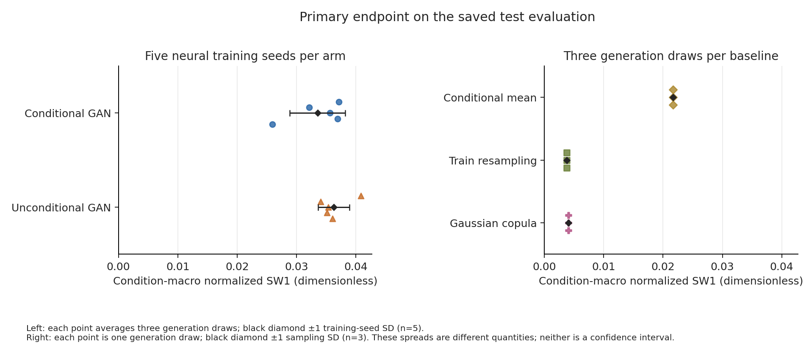
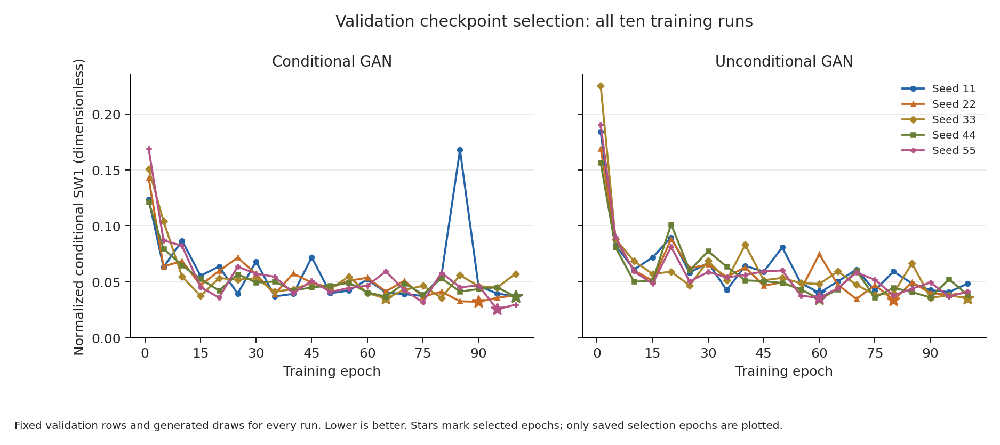
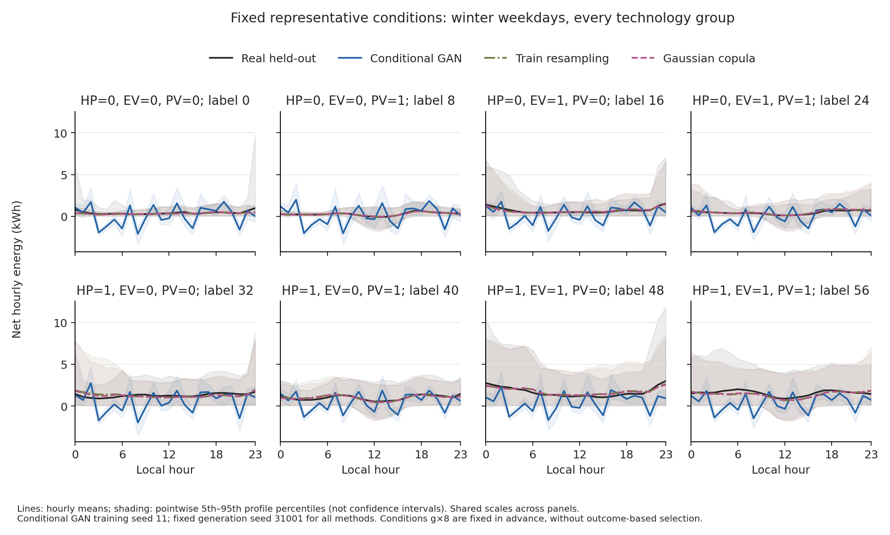

# Phase 1 results: reference cGAN on Fluvius

The reference architecture was implemented and the frozen Phase 1 benchmark
completed. **The fitted cGAN does not meet the intended standard for a reliable
profile generator.** Its held-out distribution error exceeds both complete-day
resampling and the empirical Gaussian copula across all training seeds and
all 64 conditions. These results support a negative finding about this
implementation under the declared data preparation and training budget; they
do not establish that the architecture can never work on Fluvius.

The implementation and benchmark are ready for review. A claim of competitive
generation quality or publication readiness is not supported. Phase 2,
including architecture changes and federated learning, awaits the user's
explicit approval.

## What was run

The network dimensions, activations, dropout, losses and optimizer settings
follow the audited upstream code. The target is 24 hourly signed net-import
energies per day, conditioned on reported HP/EV/PV indicators, weekday/weekend
and season. The upstream 10,000-epoch training duration was **not** reproduced:
the frozen CPU study used 100 epochs. See the [methods](PHASE1_METHODS.md),
[protocol](PHASE1_PROTOCOL.md), and [provenance](PROVENANCE.md).

After complete-trace alias removal, TRAIN/VAL/TEST contain
1,665/353/349 meters and 606,060/128,492/127,036 daily profiles. All retained
days have 24 complete hourly values. Normalization uses TRAIN only.

Five declared seeds, **11, 22, 33, 44, 55**, were run for both conditional and
unconditional GANs. All ten runs completed 100 epochs using every training
profile, with no failed attempts or replacement seeds. The study took about
86.9 wall-clock minutes on the four-core CPU environment. Validation alone
selected checkpoints, using the same fixed rows, noise and projections.

Thirteen final reports cover the ten fitted neural models and three TRAIN-only
baselines. Each uses all 127,036 test days, an equal number of generated days
within each condition, and generation seeds **31001, 31002, 31003**.
Performance evaluation followed the committed protocol. Historical data access
and its limits remain disclosed in the provenance; this is not a claim that
the held-out identities were never previously inspected.

## Primary and energy-distribution results

Smaller values are better for both error metrics. The primary endpoint is
profile sliced Wasserstein-1 divided by the training range, with equal weight
for each of the 64 conditions. It is dimensionless and is **not a percentage
error or accuracy score**. Daily-energy W1 compares distributions of signed
daily totals, in kWh.

| Method | Primary normalized profile SW1 | Reported SD | Daily-energy W1, kWh |
| --- | ---: | ---: | ---: |
| Reference conditional GAN | 0.033563 | 0.004687, training seeds | 11.4555 |
| Matched unconditional GAN | 0.036304 | 0.002653, training seeds | 12.1582 |
| Conditional mean | 0.021675 | 0, deterministic | 9.9166 |
| Conditional complete-day resampling | 0.003781 | 0.00002490, generation draws | 1.3886 |
| Conditional empirical Gaussian copula | 0.004032 | 0.00001402, generation draws | 1.4344 |

Neural means average the five model-specific means over three generation draws.
Their SD is the sample SD across the five training seeds. Baselines have one
TRAIN fit; their SD is across the three generation draws. These quantities
describe different sources of variation and are not confidence intervals.
The cGAN's within-model primary generation SD ranges from 0.00000384 to
0.00003161, substantially below its training-seed SD.

The cGAN's mean primary error is about **8.88 times** the resampling error and
**8.32 times** the copula error. Every cGAN seed has greater condition-level
profile SW1 than either strong comparator in all 64 conditions. Each cGAN seed
also has greater macro primary error than the conditional-mean control,
despite that control producing no within-condition diversity.

Conditioning reduces mean primary error relative to the unconditional GAN by
0.002741, but improves only three of five matched training seeds. The sample
SD of the paired differences is 0.004609. This is weak, seed-dependent evidence
of benefit from conditioning, and does not establish competitive fidelity.

The [technology-group figure](../reports/phase1/figures/technology_errors.png)
and [condition-level CSV](../reports/phase1/figures/condition_metrics.csv)
show the equipment and calendar breakdown without selecting favorable groups.

## All training seeds and convergence

Each row below uses the mean of its three final generation draws.

| Training seed | cGAN selected epoch | cGAN primary SW1 | Unconditional primary SW1 | cGAN daily-energy W1, kWh | cGAN diversity ratio |
| --- | ---: | ---: | ---: | ---: | ---: |
| 11 | 100 | 0.037160 | 0.040875 | 11.8603 | 0.494 |
| 22 | 90 | 0.032169 | 0.034081 | 17.0417 | 0.977 |
| 33 | 65 | 0.035615 | 0.035384 | 9.9989 | 0.377 |
| 44 | 100 | 0.036901 | 0.035118 | 9.4586 | 1.810 |
| 55 | 95 | 0.025971 | 0.036063 | 8.9183 | 1.020 |

Validation curves oscillate. Two of five cGAN checkpoints are selected at the
100-epoch boundary, and four are selected at epoch 90 or later. Convergence
has not been demonstrated. The budget is a material limit on the conclusion;
these results cannot establish the outcome of the upstream 10,000-epoch
schedule. The best seed is reported alongside all other seeds and is not
promoted to a newly selected final model.

Diversity is also inconsistent. Ratios near one in some seeds coexist with
substantial variance loss or excess in others. The five-seed mean ratio
0.936 conceals a range of 0.377–1.810. Mean lag-1 ACF distribution error is
0.4932 for the cGAN, compared with 0.0211 for resampling and 0.0573 for the
copula, indicating poor within-day temporal fidelity.

The fixed winter-weekday examples below show pronounced artificial hour-to-hour
oscillations in the seed-11 cGAN mean, across equipment groups. These are the
predeclared example conditions. Shading shows pointwise profile percentiles,
not uncertainty in the estimated mean.

## Declared meter-cluster uncertainty

The protocol specified 499 whole-meter bootstrap draws, stratified by equipment
group, for the **training-seed-11, generation-seed-31001 exemplar**. Every draw
retained all 64 conditions. Positive differences mean greater cGAN error.

| Comparator | Observed primary difference | Percentile 95% interval | Observed daily-energy W1 difference, kWh | Percentile 95% interval, kWh |
| --- | ---: | --- | ---: | --- |
| Complete-day resampling | +0.033357 | [+0.031496, +0.032967] | +10.4303 | [+8.8912, +10.7325] |
| Empirical Gaussian copula | +0.033136 | [+0.031398, +0.032793] | +10.4156 | [+8.9244, +10.5815] |

These are marginal percentile intervals conditional on fixed models, fixed
synthetic draws and the shared calendar. They are **not intervals for the
five-seed mean**, simultaneous intervals across endpoints, or estimates of
future-year generalization.

Both primary percentile intervals lie below their observed point differences.
This displacement can arise from finite-sample bootstrap bias in nonlinear
empirical-distance comparisons; it is not corrected or hidden after observing
the results. The implementation and normalization were independently checked,
but interval coverage for this data-generating process has not been established.
The intervals consistently have positive signs, yet they are not used here to
claim a calibrated significance level. The separately reported point
comparisons across all seeds and conditions carry the main fidelity conclusion.
Exact values and estimator metadata are in
[inference.json](../reports/phase1/inference.json).

## Proximity to training profiles

For each method's fixed exemplar, 256 generated and 256 held-out query profiles
per condition were compared with all same-condition training profiles: 16,384
queries of each type. Distances are physical hourly-profile RMSE.

| Query source | Mean of 64 condition-specific median distances, kWh | Exact training-profile matches among queries |
| --- | ---: | ---: |
| Conditional GAN | 1.0187 | 0 / 16,384 |
| Unconditional GAN | 1.2406 | 0 / 16,384 |
| Conditional mean | 0.1513 | 0 / 16,384 |
| Complete-day resampling | 0 | 16,384 / 16,384 |
| Empirical Gaussian copula | 0.3488 | 0 / 16,384 |
| Real held-out profiles | 0.3119 | 3 / 16,384 |

The displayed distance is a mean of condition medians, not a pooled median.
Resampling's exact copies are expected by construction. The cGAN's greater
distance is consistent with its poor fidelity; it is not evidence of desirable
novelty. No exact matches were found among the sampled GAN queries, which
provides no privacy guarantee. Three identical held-out *days* remain despite
removal of complete-trace aliases; complete-year identity and individual-day
equality are different properties.

## Verification and review artifacts

The software suite passed **220 synthetic tests with warnings treated as
errors** before the final experiment. CPU environment setup and a standalone
wheel installation passed, and the training/evaluation code revisions passed
GitHub Actions. These checks validate implementation properties, not model
quality. See the [software verification record](../reports/PHASE1_SOFTWARE_VERIFICATION.json).

Independent saved-result checks verified the ten completed budgets, selected
validation minima and checkpoint hashes, thirteen report hashes, macro and
weighted aggregation, generation and training SDs, paired differences, interval
normalization, and test-access/completion records. The
[review record](../reports/phase1/README.md) contains exact summaries, all
training histories, CSV tables, figures and provenance. The full checkpoint
archive has a per-file SHA-256 inventory and excludes the source dataset.

## Scope of the scientific conclusion

The stronger baselines fit TRAIN only. Resampling copies complete training
days and therefore is a fidelity comparator, not a claim of novel or private
generation. The copula provides an additional comparator without neural
training. The conditional mean demonstrates why a low score on a single
metric cannot establish useful diversity.

Five training seeds, three generation draws, and meter-cluster uncertainty
provide complementary evidence; none is a proof of general validity. All
splits share 2024 weather and calendar conditions. Equipment flags are reported
metadata, exact alias removal does not exclude near-duplicates, and the
balanced equipment sample does not estimate population prevalence. Daily
generation does not establish coherent yearly trajectories or household
privacy. Prior development access and unavailable upstream training data
further limit reproduction claims.

This record can support a transparent benchmark or negative-result account.
It does not support a paper claim that this cGAN produces realistic,
competitive Fluvius profiles. Any additional training or model development
must be identified as subsequent development after these test results have
been observed, with an appropriate evaluation plan. The current record is
preserved without tuning against its final test scores.
