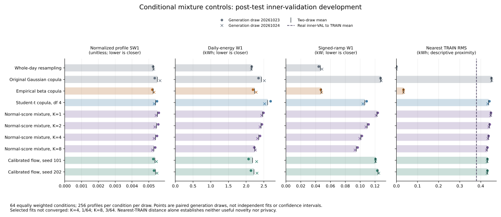

# Conditional mixture controls: the declared 100-iteration screen

Eight-component normal-score mixtures improve several mean fidelity scores over the original Gaussian copula, including daily energy and ramps. The stronger benchmark also exposes unresolved peak, extreme-ramp and condition-specific energy-tail errors. Three selected eight-component fits reach the iteration limit, and two components have very small occupancies. This is useful development evidence, not a completed robustness study or a publishable improvement of the cGAN.

All **K=1, 2, 4 and 8** results are retained. This report covers the original 100-iteration screen only. A later, separately recorded check can increase the optimization budget and repeat independent fit seeds; it must not replace these outcomes.



The [SVG](comparison.svg) and [PNG](comparison.png) show both actual generation draws and their means. They contain no confidence intervals or significance claims. Proximity to TRAIN has no universally preferable direction.

## Fixed study and preserved artifacts

The run completed on 2026-10-21 using code commit `69a041b7602f802c9cc6f4d74c3d5b830b1eadc3`. The [plan](plan.json) and [construction specification](../../../docs/MIXTURE_BASELINE_PLAN.md) were fixed before fitting. Each condition receives a separate full-covariance Gaussian mixture fitted to randomized-rank normal scores from inner-TRAIN. Every arm uses fit seed `20261027`, two separately recorded starts, k-means++ initialization, at most 100 EM iterations, tolerance `0.001`, and covariance diagonal regularization `0.001`. Selection uses the largest final TRAIN mean log density, with the earliest exact tie retained. No validation score selects an initialization.

Generated latent vectors pass through the **full mixture marginal CDF**, including every component, and then the empirical TRAIN inverse. The analytic transform preserves hourly marginal probabilities in law; it does not force finite generated batches to have exact frequencies. Normal-score EM is a surrogate estimator, not Gaussian-mixture copula maximum likelihood. Component labels do not identify appliances, building types or causal subpopulations. The K=1 arm controls this changed fitting/tie pipeline; the original Gaussian copula remains a separate comparator because its rank and shrinkage rules differ.

The eight new draws use the same 16,384 inner-VAL profiles, 64 equally weighted conditions and generation seeds `20261023`/`20261024` as the earlier studies. All fits use 485,212 inner-TRAIN profiles. The inner splits come from original TRAIN and have disjoint meters. Thirty historical draws from 15 methods are copied and verified without refitting or regeneration. This run accesses neither original validation nor TEST performance and performs no neural checkpoint reselection. Historical TEST exposure and repeated inner-validation use make these **post-test development results**, not independent confirmation.

[DERIVATION.json](DERIVATION.json) binds this extraction to all 48 source artifact hashes. It verifies the four saved model files by streaming SHA-256 only; no fitted arrays are deserialized during reporting. Ten JSON/CSV files are preserved byte-for-byte. All 19 methods remain in [summary.json](summary.json), [metrics.csv](metrics.csv), [condition_diagnostics.csv](condition_diagnostics.csv) and [method_comparison.csv](method_comparison.csv). No dataset, generated profile array or fitted NPZ is included in this tracked bundle.

## Mean fidelity, with every declared setting

Each value averages the two paired draws for a fixed fit. Lower is better for these distance/error metrics. Normalized profile SW1 divides physical profile SW1 by the fixed TRAIN range, 33.619001388549805 kWh. Hourly peak and signed-ramp W1 use kW.

| Method | Normalized SW1 | Energy W1 (kWh) | Peak W1 (kW) | Ramp W1 (kW) | Lag-1 ACF W1 |
|---|---:|---:|---:|---:|---:|
| Conditional mean | 0.020827 | 9.5077 | 1.4332 | 0.28281 | 0.33442 |
| Whole-day resampling | 0.005272 | 2.1529 | 0.3420 | 0.04641 | 0.03048 |
| Original Gaussian copula | 0.005509 | 2.4310 | 0.5313 | 0.12789 | 0.05926 |
| Empirical beta copula | 0.005260 | 2.2364 | 0.3511 | 0.04760 | 0.03109 |
| Student-t, df 4 | 0.005406 | 2.6054 | 0.4116 | 0.10628 | 0.04676 |
| Student-t, df 8 | 0.005423 | 2.5228 | 0.4398 | 0.11379 | 0.05057 |
| Student-t, df 16 | 0.005459 | 2.4224 | 0.4716 | 0.12111 | 0.05333 |
| Normal-score mixture, K=1 | 0.005515 | 2.4650 | 0.5229 | 0.12271 | 0.05693 |
| Normal-score mixture, K=2 | 0.005463 | 2.4199 | 0.5175 | 0.10961 | 0.04908 |
| Normal-score mixture, K=4 | 0.005405 | 2.3573 | 0.5126 | 0.10102 | 0.04275 |
| Normal-score mixture, K=8 | 0.005303 | 2.2456 | 0.4896 | 0.09490 | 0.04084 |
| Raw cGAN, seed 101 | 0.006955 | 3.4008 | 0.5682 | 0.10675 | 0.04717 |
| Calibrated cGAN, seed 101 | 0.005656 | 2.3259 | 0.6075 | 0.11696 | 0.05551 |
| Raw cGAN, seed 202 | 0.006698 | 3.1755 | 0.5574 | 0.09468 | 0.04944 |
| Calibrated cGAN, seed 202 | 0.005536 | 2.4340 | 0.5288 | 0.09209 | 0.05248 |
| Raw flow, seed 101 | 0.005535 | 2.2609 | 0.4390 | 0.13791 | 0.05191 |
| Calibrated flow, seed 101 | 0.005361 | 2.1823 | 0.4622 | 0.12075 | 0.05265 |
| Raw flow, seed 202 | 0.005348 | 2.1052 | 0.4352 | 0.15632 | 0.05697 |
| Calibrated flow, seed 202 | 0.005399 | 2.2211 | 0.4460 | 0.12413 | 0.05477 |

Against the original Gaussian copula, K=8 lowers mean SW1 by 3.74%, energy W1 by 7.63%, peak W1 by 7.85%, ramp W1 by 25.79%, and lag-1 ACF W1 by 31.08%. Its ramp error is lower in 58/64 and 60/64 conditions in the two draws. Against K=1, K=8 lowers ramp error in 63/64 conditions in each draw, with mean SW1 and energy reductions of 3.84% and 8.90%. This supports studying mixture dependence further, while the condition counts remain descriptive rather than independent statistical tests.

K=8 also lowers mean energy W1 by 13.81% and ramp W1 by 10.70% versus Student-t df 4, but increases peak W1 by 18.96%. Against the two calibrated flows, K=8 has lower mean SW1, ramp and lag-1 errors, while energy W1 is 1.10–2.90% higher and peak W1 is 5.93–9.76% higher. Both calibrated flows retain advantages in these energy and peak scores. Across conditions, K=8 wins SW1 against either calibrated flow in only 31/64 and 33/64 groups. The small aggregate SW1 advantage is not uniform across groups or an established improvement of a neural model.

Whole-day resampling and beta remain stronger on several dependence metrics. K=8 ramp W1 is **2.04 times resampling** and **1.99 times beta**. Its peak W1 is 43.14% and 39.46% higher, respectively. K=8 wins ramp W1 against resampling in only 2/64 and 4/64 conditions, and against beta in 2/64 and 3/64. All comparisons are retained in [conditional_comparisons.csv](conditional_comparisons.csv); reporting K=8's Gaussian comparison alone would conceal this gap.

## Mean improvements do not resolve every tail

Across K=1/2/4/8, mean daily-energy quantile error decreases from 4.8798 to 4.7476, 4.6586 and 4.4930 kWh. Covariance RMSE decreases from 0.3443 to 0.3440, 0.3414 and 0.3279 kWh². The diversity ratios are 1.2414, 1.2516, 1.2445 and 1.2142; the reference is 1, so dispersion discrepancies remain in every arm.

Absolute-ramp quantile error averaged over the five recorded quantiles is 0.19768/0.19814/0.19904/0.18565 kW for K=1/2/4/8. However, the mean absolute error at **q99 alone** is 0.59067 kW for K=1 and 0.59200 for K=8. The corresponding mean signed q99 bias grows from +0.37042 to +0.44734 kW. Lower signed-ramp W1 therefore coexists with unresolved extreme absolute-ramp overestimation.

A concrete conditional tradeoff occurs in condition 55 (source HP=1, EV=1, PV=0; weekend, season index 3). Its real daily-energy q99 is 100.3553 kWh. K=8 generates q99 values of 82.2744 and 85.2574 kWh, compared with K=1's 101.8247 and 96.4833. K=8 also generates q01 values of 0.2051 and 0.4174 kWh against the real 3.3485. These local tail discrepancies are visible despite better macro energy scores. [conditional_tail_quantiles.csv](conditional_tail_quantiles.csv) retains q01/q99 for energy, peaks and absolute ramps for **every new arm, draw and condition**, not just this example.

Conditional daily/peak q99 estimates use only 256 profiles, leaving roughly two or three observations beyond that quantile. Ramp quantiles pool their 23 adjacent-hour differences, which are dependent. These sparse, reused validation tails motivate further checks; they do not support precise extreme-event inference.

## Fit convergence and component occupancies

The [512 initialization records](initializations.csv) and [960 component records](component_diagnostics.csv) retain all starts and selected-fit occupancies. Rank and normal-score hashes are identical across K, and every selected start has the largest final TRAIN score.

| K | Nonconverged starts / 128 | Nonconverged selected fits / 64 | Selected condition IDs | Minimum effective component occupancy | Minimum covariance eigenvalue |
|---:|---:|---:|---|---:|---:|
| 1 | 0 | 0 | — | 4025.00 | 0.059329 |
| 2 | 0 | 0 | — | 1120.61 | 0.007113 |
| 4 | 1 | 1 | 11 | 353.94 | 0.004613 |
| 8 | 5 | 3 | 23, 36, 37 | 2.00 | approximately 0.001 |

All nonconverged starts reached 100 EM iterations. For K=8, the two other nonconverged starts were condition 27/init 1 and condition 44/init 0; neither was selected. No unsuccessful start was silently retried or discarded. Selected iteration counts have medians 3, 17, 40 and 55 for K=1/2/4/8. Convergence of most starts does not establish that the selected likelihood optimum is global.

K=8 condition 38/component 3 has effective and hard occupancy 2, weight 0.00044623, and covariance eigenvalues reaching the 0.001 regularization floor. Condition 39/component 3 has occupancy 15 and also reaches that floor. Ten K=8 components have effective occupancy below 100. These are mathematical mixture components supported partly by regularization, not validated population segments. Their stability needs checking before drawing substantive conclusions.

The byte-identical `*_fit.json` files are fit-stage snapshots saved before verified reload and retain `status: running`. Their metadata and model hashes match the completed method reports; the top-level [manifest](manifest.json) confirms completion of all eight new draws. [fit_summary.csv](fit_summary.csv) provides the completed-run context, saved-model hashes and timing information.

## Marginal support and proximity to TRAIN

All 3,145,728 generated hourly cells across the four mixture arms and two draws belong to their corresponding condition/hour's empirical TRAIN support. [marginal_support.csv](marginal_support.csv) records generated and TRAIN zero, negative, minimum and maximum counts and per-hour frequency errors for every condition and draw. The two-draw macro zero-frequency absolute errors are 0.003857/0.003812/0.003839/0.003791 for K=1/2/4/8. These are fractions, not percentages, and finite-draw sampling variation is not subtracted.

For K=8's 786,432 hourly cells, observed zero and negative counts are 6,943 and 102,903; their expectations under the fitted TRAIN marginals are 6,780.06 and 102,832.44. Observed TRAIN-minimum/maximum counts are 1,420/114 versus expectations 1,362.17/128.83. Such finite draws need not equal their expected atom frequencies. None of the new arms produces a negative total daily energy in source-PV0 groups. K=8 produces two source-PV0 days with at least one negative hourly value, both from retained negative TRAIN support. An hourly export event differs from a negative total daily energy.

Nearest-TRAIN RMS uses exhaustive same-condition Euclidean distance divided by `sqrt(24)`, in kWh. Real inner-VAL profiles have mean distance **0.37945 kWh**. Threshold fractions compare each generated distance with that condition's real p05 or median using strict `<`.

| Method | Mean nearest-TRAIN RMS (kWh) | Below real condition p05 | Below real condition median | Quantized full-row matches |
|---|---:|---:|---:|---:|
| Whole-day resampling | 0.00000 | 100.00% | 100.00% | 100.00000% |
| Original Gaussian copula | 0.45107 | 1.49% | 42.02% | 0 |
| Empirical beta copula | 0.03351 | 93.20% | 99.13% | 0.01831% |
| Student-t, df 4 | 0.43705 | 2.35% | 49.96% | 0 |
| Normal-score mixture, K=1 | 0.44750 | 1.70% | 42.58% | 0 |
| Normal-score mixture, K=2 | 0.44043 | 2.94% | 43.55% | 0 |
| Normal-score mixture, K=4 | 0.43555 | 3.47% | 44.64% | 0 |
| Normal-score mixture, K=8 | 0.42957 | 4.14% | 44.60% | 0.00916% |
| Calibrated flow, seed 101 | 0.43088 | 0.79% | 44.18% | 0 |
| Calibrated flow, seed 202 | 0.43078 | 0.66% | 44.59% | 0 |

K=8 does not show beta's widespread near-resampling pattern in these diagnostics, but that establishes neither useful novelty nor privacy. Its three quantized full-row matches occur in condition 55 in both draws and condition 22 in the second draw. **Those conditions differ from the tiny-component conditions 38 and 39.** These artifacts do not support attributing the matches to the tiny components, identifying the matched source rows, or assuming they are all-zero profiles. Exact-match precision is little-endian float32 for all 24 coordinates; the absence of matches in another arm would not certify privacy either.

## Reproduction and remaining work

From the repository root, with the completed local artifacts available:

```bash
MPLCONFIGDIR=/tmp/cgan-report-matplotlib .venv/bin/python reports/phase1-development/mixture_baselines/derive_summary.py
```

The command verifies every source artifact, the unchanged historical report hashes and scores, saved-model hashes, TRAIN-only start selection and common rank streams. It extracts the compact tables and figure without dataset access, array/model loading, sample generation or physical-metric reevaluation. The receipt records the derivation script, derived artifact hashes, and NumPy/Matplotlib versions. The copied evaluator CSVs preserve their original line endings. Full per-draw reports and NPZ models stay in `artifacts/phase1-development/mixture_baselines` and are bound by the manifest.

Fitting took 4.07/14.16/42.17/95.26 seconds for K=1/2/4/8 in this four-process run with one numerical thread per arm. Generating 16,384 profiles took 0.033/0.040/0.056/0.097 seconds on average; exact nearest-neighbor scoring took about one second per draw. These timings are hardware- and implementation-specific and include no earlier neural training.

The next bounded check should resolve optimizer-budget sensitivity, repeat fit seeds, and broaden scoring to the full development validation meters while preserving the original 100-iteration outcomes. It should examine condition-specific tails and occupancy stability alongside mean fidelity. More component counts or generation draws alone would not answer those questions. This stronger classical comparator raises the standard for subsequent Phase-1 cGAN improvements; the present study does not establish a novel architecture, generalization beyond the available year, independent confirmation, or publication readiness.
