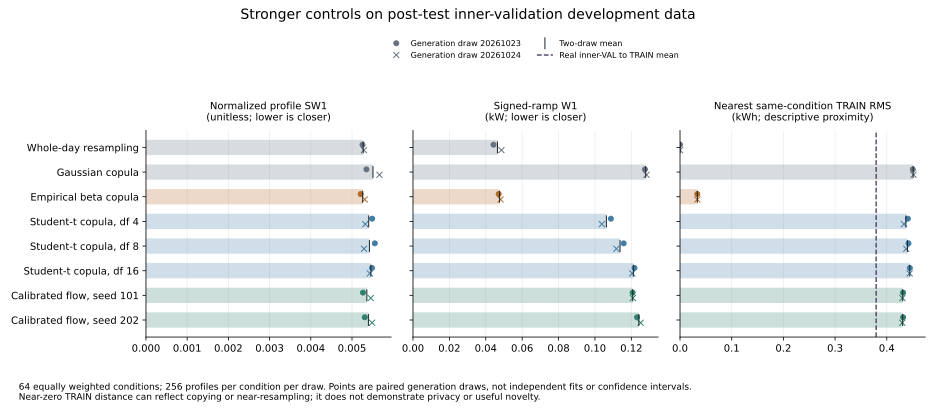

# Stronger conditional baselines and proximity to training profiles

The empirical beta copula provides a strong fidelity control, but generates profiles very close to training examples. Student-t copulas improve several temporal metrics over the existing Gaussian copula while exposing an energy-distribution tradeoff. These results strengthen the benchmark; they do not yet establish a publishable improvement of the cGAN.

This is **post-test inner-validation development evidence**. It reuses the previously selected validation profiles and paired generation seeds. It is not independent confirmation, a new holdout evaluation, or a privacy assessment.



The [SVG](comparison.svg) and [PNG](comparison.png) show both actual draws and their mean. The dashed proximity reference is real inner-validation data compared with training data. Proximity has no universal preferable direction.

## Fixed comparison and provenance

The run completed on 2026-10-21 with 30 draws across 15 methods, using evaluation code at commit `d96ff765b42230d6d16d1e164ce87361d1de20b6`. Each draw contains 16,384 profiles: 256 in each of 64 HP/EV/PV, weekend and season conditions. All conditions receive equal weight. The generation seeds are `20261023` and `20261024`; they measure sampling variation for fixed fits, not independent model training replications.

All new fits use the 485,212 inner-TRAIN profiles only. Their same-condition training reference sizes range from 4,025 to 11,088. Inner-TRAIN and inner-VAL were formed within the original TRAIN population with disjoint meters. This run accesses neither original validation nor TEST performance, refits no neural model or marginal calibration, and performs no checkpoint reselection. Historical TEST exposure still prevents treating this development sequence as a pristine confirmatory study.

The [fixed plan](plan.json), [design specification](../../../docs/DEPENDENCE_COMPARISON_PLAN.md) and [source review](../STRONG_BASELINES_SOURCE_REVIEW.json) describe the estimators:

- **Empirical beta copula:** fit seed `20261026` resolves ties into complete hourly rank permutations. A common training row selects beta parameters, with independent beta draws across hours followed by the fitted empirical marginal inverse. It preserves empirical marginal distributions in law, including atoms. This is a declared tied-data extension of the empirical beta construction; no smoothing bandwidth was tuned here.
- **Student-t copulas:** fixed degrees of freedom 4, 8 and 16; average ranks; t-score correlation; identity shrinkage 0.01; eigenvalue floor `1e-8`; and one shared chi-square scale per generated profile. These are moment-based dependence fits, not maximum-likelihood fits. Ties and symmetric tail dependence remain limitations.
- **Existing controls:** conditional mean, whole-day resampling and the original Gaussian copula remain unchanged. The frozen raw and marginal-calibrated cGAN/flow models are included for context.

All 24 evaluator artifact hashes were verified before extraction. The 22 existing-method draws independently matched the frozen reference JSON reports in both generated-profile hashes and complete physical-metric records. The ten copied artifacts in [DERIVATION.json](DERIVATION.json) are byte-identical to the completed run. Full per-draw JSON remains in the local artifact directory; this compact bundle preserves their hashes, aggregate metrics, condition diagnostics and fit metadata without generated arrays or checkpoints.

## Fidelity across all declared methods

Values are means of the two paired draws. Lower is better for these distance/error metrics. Normalized profile SW1 divides kWh profile SW1 by the fixed TRAIN range, **33.619001388549805 kWh**. Peak and signed-ramp metrics use hourly power in kW. All raw and calibrated neural scores reproduce the preceding calibration study exactly.

| Method | Normalized SW1 | Energy W1 (kWh) | Peak W1 (kW) | Ramp W1 (kW) | Lag-1 ACF W1 |
|---|---:|---:|---:|---:|---:|
| Conditional mean | 0.020827 | 9.5077 | 1.4332 | 0.28281 | 0.33442 |
| Whole-day resampling | 0.005272 | 2.1529 | 0.3420 | 0.04641 | 0.03048 |
| Gaussian copula | 0.005509 | 2.4310 | 0.5313 | 0.12789 | 0.05926 |
| Empirical beta copula | 0.005260 | 2.2364 | 0.3511 | 0.04760 | 0.03109 |
| Student-t, df 4 | 0.005406 | 2.6054 | 0.4116 | 0.10628 | 0.04676 |
| Student-t, df 8 | 0.005423 | 2.5228 | 0.4398 | 0.11379 | 0.05057 |
| Student-t, df 16 | 0.005459 | 2.4224 | 0.4716 | 0.12111 | 0.05333 |
| Raw cGAN, seed 101 | 0.006955 | 3.4008 | 0.5682 | 0.10675 | 0.04717 |
| Calibrated cGAN, seed 101 | 0.005656 | 2.3259 | 0.6075 | 0.11696 | 0.05551 |
| Raw cGAN, seed 202 | 0.006698 | 3.1755 | 0.5574 | 0.09468 | 0.04944 |
| Calibrated cGAN, seed 202 | 0.005536 | 2.4340 | 0.5288 | 0.09209 | 0.05248 |
| Raw flow, seed 101 | 0.005535 | 2.2609 | 0.4390 | 0.13791 | 0.05191 |
| Calibrated flow, seed 101 | 0.005361 | 2.1823 | 0.4622 | 0.12075 | 0.05265 |
| Raw flow, seed 202 | 0.005348 | 2.1052 | 0.4352 | 0.15632 | 0.05697 |
| Calibrated flow, seed 202 | 0.005399 | 2.2211 | 0.4460 | 0.12413 | 0.05477 |

The beta copula reduces Gaussian-copula mean SW1 by 4.51%, peak W1 by 33.92%, and ramp W1 by 62.78%. Its SW1 is only 0.23% below whole-day resampling; energy, peak, ramp and lag-1 errors are 1.99–3.88% higher. Beta wins SW1 against resampling in 30/64 and 35/64 conditions in the two draws. These mixed, small differences do not support a general superiority claim over resampling.

Relative to Gaussian, df 4 reduces mean SW1 by 1.87%, peak W1 by 22.53%, ramp W1 by 16.90%, and lag-1 ACF W1 by 21.10%, but **increases energy W1 by 7.17%**. Its ramp errors are lower in 49/64 conditions in both draws. Degrees of freedom 8 and 16 retain smaller peak/ramp/ACF gains. Their energy W1 changes are +3.77% and -0.36%, respectively. All three fixed settings are reported; none is promoted to an independently validated winner.

Both calibrated flows have lower mean SW1 and energy W1 than df 4, while df 4 has lower peak, ramp and lag-1 errors. Beta has lower mean peak, ramp and lag-1 errors than both calibrated flows; its ramp error is lower in all 64 conditions in each draw. The calibrated flows have slightly lower energy W1 than beta. Thus, the stronger controls expose remaining dependence errors without establishing a single metric-independent winner. The original cGAN and its calibrated forms do not dominate these controls.

Tail and dispersion diagnostics also qualify the gains. The daily-energy quantile error is 6.2631 kWh for df 4 versus 4.9710 for Gaussian, and 4.6256 for beta versus 4.2180 for resampling. Covariance RMSE is 0.4124 kWh² for df 4 versus 0.3467 for Gaussian. Diversity ratios, whose reference is 1, are 1.2346 for beta and 1.3142/1.2863/1.2900 for df 4/8/16, versus 1.2503 for resampling and 1.2791 for Gaussian. Improvements in some temporal scores therefore coexist with persistent energy-tail and dispersion discrepancies.

The TRAIN marginal support suppresses excess source-PV0 hourly exports: beta, resampling and Gaussian each produce one export day across the two draws' 16,384 source-PV0 profiles (0.00610%); all three t settings produce zero. All four new controls have zero negative total daily energies in source-PV0 groups. An **export day** means any negative hourly import and differs from a **negative total daily energy**. No clipping or assumption that every source-PV0 anomaly is physically impossible is used.

## How close are generated profiles to TRAIN?

For each query, the diagnostic exhaustively finds the closest inner-TRAIN profile with the same condition. The distance is `sqrt(sum_hour((query - train)**2) / 24)` in kWh. It uses no approximate nearest-neighbor index. Real inner-VAL profiles have a macro mean distance of **0.37945 kWh**; the mean of their 64 conditional medians is **0.31587 kWh**.

Threshold percentages below are evaluated against each condition's own real inner-VAL 5th percentile or median, with strict `<` and NumPy linear quantiles. They are descriptive reference comparisons, not calibrated hypothesis tests. The CSV also contains means of conditional 1st/5th/50th/95th/99th percentiles; those are not pooled quantiles.

| Method | Mean nearest-TRAIN RMS (kWh) | Below real condition p05 | Below real condition median |
|---|---:|---:|---:|
| Conditional mean | 0.15633 | 6.25% | 100.00% |
| Whole-day resampling | 0.00000 | 100.00% | 100.00% |
| Gaussian copula | 0.45107 | 1.49% | 42.02% |
| Empirical beta copula | 0.03351 | 93.20% | 99.13% |
| Student-t, df 4 | 0.43705 | 2.35% | 49.96% |
| Student-t, df 8 | 0.43992 | 1.99% | 47.30% |
| Student-t, df 16 | 0.44450 | 1.82% | 44.48% |
| Raw cGAN, seed 101 | 0.33610 | 3.61% | 51.37% |
| Calibrated cGAN, seed 101 | 0.43691 | 5.49% | 44.62% |
| Raw cGAN, seed 202 | 0.33611 | 3.99% | 52.98% |
| Calibrated cGAN, seed 202 | 0.42254 | 5.55% | 47.10% |
| Raw flow, seed 101 | 0.43728 | 0.20% | 36.40% |
| Calibrated flow, seed 101 | 0.43088 | 0.79% | 44.18% |
| Raw flow, seed 202 | 0.45272 | 0.15% | 32.70% |
| Calibrated flow, seed 202 | 0.43078 | 0.66% | 44.59% |

Whole-day resampling has exactly zero distances and 100% quantized full-profile matches, as required by its construction. Beta has only 6 quantized full-profile matches among 32,768 draws (0.01831%), yet 93.20% of its profiles are closer to TRAIN than the corresponding real 5th percentile. **Low exact-copy counts alone would miss its strong near-resampling behavior.** All other methods have zero quantized exact matches in these draws; that establishes neither useful novelty nor privacy.

The mean baseline illustrates another limit: small TRAIN distance can accompany zero diversity and poor distributional fidelity. Conversely, larger distance can arise from unrealistic profiles. Nearest-TRAIN distance must be interpreted alongside fidelity, tails and dependence, and does not certify resistance to membership inference or reidentification.

## Reproduction and next scientific use

From the repository root, after the completed evaluation artifacts are present:

```bash
MPLCONFIGDIR=/tmp/cgan-report-matplotlib .venv/bin/python reports/phase1-development/strong_baselines/derive_summary.py
```

This command verifies every source artifact, checks the frozen reference reports, copies the ten preserved artifacts, and derives the two compact CSVs and figure. It does not load the dataset, fitted model arrays or checkpoints, generate samples, or recompute physical metrics. [DERIVATION.json](DERIVATION.json) binds the script and derived files to the completed source manifest. Exact figure bytes use the recorded NumPy/Matplotlib versions. The copied evaluator CSVs intentionally preserve their original line endings.

[method_comparison.csv](method_comparison.csv) provides full-precision means, tail/proximity diagnostics and separate fit/generation/metric/nearest-neighbor timings. [conditional_comparisons.csv](conditional_comparisons.csv) reports all four new controls against Gaussian/resampling and all four calibrated neural fits against each new control, separately for both draws. These 288 metric comparisons are descriptive; conditions, draws and repeated days are not independent experimental replications. The complete per-draw metrics and diagnostics remain in [metrics.csv](metrics.csv), [condition_diagnostics.csv](condition_diagnostics.csv) and [summary.json](summary.json).

On this single-thread CPU run, beta fitting took 2.05 seconds and the t fits took 19.98–24.16 seconds; generating 16,384 profiles took 0.044 seconds for beta and 0.086–0.106 seconds for t. Exact nearest-neighbor queries took about one second per draw. These measured timings are implementation- and hardware-specific, and exclude any earlier neural training or calibration costs.

These controls should remain in subsequent Phase-1 comparisons. A dependence-focused neural improvement must address their peak/ramp/ACF strengths while improving the energy distribution, preserving marginal support, and avoiding conclusions based on near-resampling. Additional generation draws alone cannot supply independent training-seed, meter-level or external-validation evidence. The current single-year development study supports a stronger experimental foundation, while model superiority, useful synthetic novelty and publication readiness remain unestablished.
